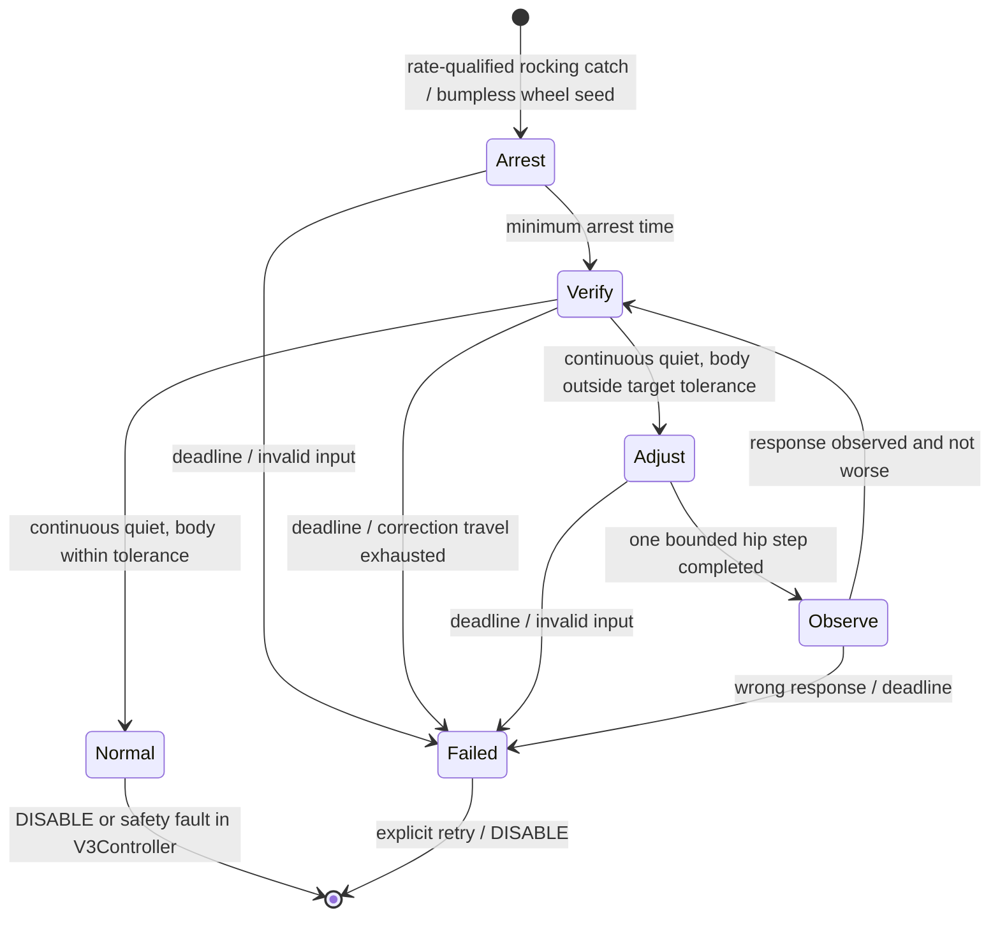

# Stand-up capture governor — implementation and release gates

Status: experimental, core-default-off. The **12:44 catch/progress revision is
restored and currently flashed**; later window/encoder qualification and the
IMU tipping detector have been withdrawn after worse robot behavior. Broad
release and physical pitch stability remain unverified. See the rollback record
in [`STANDUP_IMU_TIPPING_CAPTURE_20261014.md`](STANDUP_IMU_TIPPING_CAPTURE_20261014.md).
The former 13:30 window/encoder prototype was `6886d6e4…cedc2d2`.
Catch/progress corrections were flashed at the user's request at 12:44; see
[`STANDUP_CAPTURE_REVIEW_20261014.md`](STANDUP_CAPTURE_REVIEW_20261014.md).
This document defines the subsystem being developed, not a claim that robot
pitch oscillation has been solved.
The subsequent window/encoder qualification revision was **flashed at the
user's request at 13:30 and is now withdrawn**. See
[`STANDUP_CAPTURE_WINDOW_REVIEW_20261014.md`](STANDUP_CAPTURE_WINDOW_REVIEW_20261014.md)
for the new robot-log evidence, changes and unresolved wheel-loop cases.

## Failure evidence and scope

Four attempts in `tap_20261014_114724.log` never reached Normal. In attempts
3/4, fixed-catch body-rate RMS was 0.381/0.367 rad/s; posture transfer increased
it to 1.173/1.145 rad/s. Knee commands stayed 0.0061 rad; held resets stayed zero.
The hip moved 0.6973→0.4775 and 0.6940→0.4196 rad. Thus the older fixed CAD
endpoint could amplify an already oscillating wheel/body loop.

Command-to-measured wheel spectral response at the dominant 2.5–2.8 Hz was
approximately gain 0.38–0.43 and phase −100…−108 degrees in these windows.
These are closed-loop observations, not independently calibrated actuator
constants. The old planar test used 0.03 s lead; the adapter actually selects
0.05–0.09 s. Revised diagnostics explicitly accept the deployed 0.09 s and the
adapter's trim-acceleration/height-share/body-damping overrides. No 0.12 s or
0.20 s lead change is being shipped from the exploratory sweep.

## Boundaries and frames

`BalanceCaptureGovernor.hpp` owns posture reference progression, observation,
acceptance and rejection. V3Controller retains the wheel stabilizer, sensors,
fall guards, command priority, sensor-loss faults and leg POS output. UART and
motor protocol are unchanged. The governor uses only body IMU and encoder-derived
virtual lean, wheel speed and sent command; no contact/current/force signal.
Quiet motion is a control qualification, **not proof of floor contact**.

Body pitch is the mounted/bias-corrected IMU coordinate. Hip is the existing
core command coordinate. The observed sign is: a negative hip change tends to
increase body pitch at approximately fixed virtual lean. Wrong response is
rejected, not silently reinterpreted. The diagnostic geometry remains unverified;
no replacement CAD model or inertia parameters are introduced.

## One episode, explicit transitions

Each new adjustment is relative to the delivered and observed pose. It does not
follow a distant nominal CAD hip goal. A step is bounded to 0.015 rad, with rate
0.04 rad/s and acceleration 0.20 rad/s² during qualified motion. Loss of quiet
stops posture progression immediately. Both encoder hip positions must track
the issued core target within 0.008 rad; each hip rate must be <=0.06 rad/s
and its pose span <=0.004 rad across the qualification window. These are
provisional noise/tracking allowances, not measured actuator specifications.
Observe waits at least 0.5 s and requires a complete continuous quiet window
at the delivered pose before assessing the body response. Before/after errors
and progress are time-weighted means; a single endpoint no longer rejects the
episode. A stationary mean error increase >0.01 rad still rejects it.
Pitch span >0.03 rad or an endpoint more than 0.01 rad from its window mean
clears the window and waits at the same pose. Body/virtual-rate RMS above
max(0.10 rad/s, 1.5 times the qualified pre-step rate RMS) pauses adjustment
and observation even below the absolute quiet limit. Observe carries its
completed window into Verify; a disturbance clears it before another step.
Maximum cumulative correction is 0.35 rad. The initial deadline is 30 s; a
quiet observed improvement of at least 0.01 rad can renew 3 s of progress time,
with a hard 45 s episode ceiling. Motion or noisy nonresponse cannot renew it.
These are explicit provisional
supervisor parameters, not measured mechanical or actuator capabilities.

Qualification uses exponentially weighted squared body/virtual rates and lean
residual (time constant 0.4 s), instantaneous rate bounds, wheel speed and sent
command bounds, plus 0.5 s uninterrupted quiet. Defaults: rate RMS <0.20 rad/s,
lean residual RMS <0.025 rad, measured speed RMS <0.10 m/s, command RMS <0.15 m/s, instantaneous speed/command <0.25 m/s, body rate <0.35 rad/s,
virtual rate <0.40 rad/s. Normal requires the entire qualified body's error
window to remain within 0.08 rad relative to target 0 rad, then holds the
accepted hip/knee pair. Energy and tracking telemetry continue updating in
Normal; no new posture transfer starts automatically on a disturbance.

Rocking catch separately checks body and COM-line rates (<0.7 rad/s) over at
least 0.05 s. This prevents a cancelling joint velocity from masking a rapidly
rotating body. The working-tree correction also accepts the lean at the actual
trimmed hip goal within the inner tolerance and the existing 0.0654 rad outer
corridor; the original zero-crossing band remains accepted. This resolves the
contradiction between a trimmed endpoint and a zero-centred catch gate, without
inferring support or changing the legacy flag-off path.
The wheel equilibrium seed uses a bounded rate/omega release
estimate (Pratt et al., Capture Point, Humanoids 2006); effective height remains
an unverified model input, so that correction is limited to 0.04 rad.
The wheel command integrator starts at measured wheel speed without creating a
DRIVE reference, and computes the first stabilizer command in the catch tick.

The earlier stand-only 0.6 m/s command cap, per-wheel excess-speed fault,
sustained-saturation fault, DISABLE and stale/fall guards remain in force.
A longer posture-observation budget does not widen any fall limit.

## Integration and compatibility

`SET capturegov 1` selects the complete profile while Idle/Fault: smooth,
supervised, fresh-seed capture, stand-speed envelope and static final pose are
selected together. `SET capturegov 0` turns those selections off together.
The subsequent IMU tipping detector and `catchpredict` GUI option were tested
and withdrawn; the geometric catch is active again. Legacy SET names remain for
previous experiments. GUI STANDUP sends
`SET capturegov 1` in its seven-command profile; opening the GUI does not enable
the profile or actuate motors. TR adds `cgphase` (enum order
above, 0–6) and `cgrms`. Failure messages distinguish timeout, correction travel,
wrong measured response and invalid input.
`cgblock` reports qualification blockers as a bit mask: 1 motion/speed/lean
envelope, 2 held, 4 missing/lagging hip feedback, 8 moving/drifting hip, 16
rate energy above the pre-step allowance, 32 inconsistent pitch window.

## Verification and release requirements

Synthetic contracts cover ±body offsets, 50/150/250 ms body-response delay,
jittered dt, bounded rate/travel, static Normal, rolling with quiet pitch,
commanded wheel motion, repeated low-rate crossings in an oscillation, wrong
hip response, unreachable correction, invalid input and reset/retry. They verify
state/reference logic, **not balance capability**.

Planar diagnostics run the actual V3Controller with the new governor and a
specified wheel lead. They must report terminal phase and failure, not count
an unfinished 12 s interval as success; the governor diagnostic now runs through
the 45 s maximum deadline. Existing tests/profile-off behavior must remain passing.

Release gates: successful terminal Normal in relevant nominal/delay/bias cases;
bounded failure in unrecoverable cases; no new failure hidden behind an assertion
that only checks a build; command rate/gyro metrics reported separately; then
operator-recorded robot trials at the same MIN posture. A governor cannot make
an unstable wheel stabilizer stable. If the wheel loop remains oscillatory with
fixed hip/knee, its actuator model and gains are a separate blocker, rather than
permission to move geometry until the robot falls.

## Recorded verification (2026-10-14)

- Synthetic governor contracts: pass (nine offset/delay cases plus failure,
  reset and qualification contracts). V3 and motor-feedback regression: 3/3
  including the governor target passed. Direct v3_standup_tests also passed;
  its printed diagnostic failures are not counted as successful balance cases.
- RTOS/single-loop builds passed; final rebuilt artifacts are recorded below.
- Revised planar run at explicit 0.09 s lead, with deployed trim-acceleration,
  height-share and body-damping overrides: governor reached static Normal in
  six cases (wheel lag 130/200 ms × hip delay 4/20/50 ms), final body pitch about
  −0.067 rad and body-rate RMS after 2 s about 0.016 rad/s. The old profile's
  corresponding RMS was about 0.064–0.065 rad/s. Different final body poses:
  this is not an equal-posture claim or validation of new-wheel parameters.
- With wheel lag 35 ms, the 0.09 s wheel stabilizer remained oscillatory and
  the governor stopped at its deadline in all three hip-delay cases. No fall
  in those governor intervals, but **Normal was not achieved**. This blocks
  broad release. The wheel-loop/model mismatch cannot be hidden by weakening
  qualification or forcing the body to move.
- A 0.12 s lead exploration also failed fast-wheel capture; not selected,
  not enabled in console/GUI and not flashed. The governor keeps the deployed
  wheel stabilizer settings.

Next engineering requirement: identify/validate the wheel-loop delay range and
closed-loop stability at fixed MIN pose, then expand firmware planar cases to
COM bias and initial-rate variations with the deployed adapter settings.
All simulation geometry remains provisional. Do not activate the GUI profile
or flash this prototype as a completed pitch fix before these gates pass.

Final prototype RTOS SHA256: `a4828d0b26ab9e869639b43b4624ccc4fd627a3c31367629c9282c9960e55c80`. Both firmware environments built;
three selected contract/regression targets passed.

User-authorized experimental deployment (2026-10-14 12:22, branch `fw`):
- RTOS upload succeeded in 22.333 s; esptool reported `Hash of data verified`.
- GUI Python compile and mock of the seven-command STANDUP sequence passed.
- Previous owned GUI session had no live members before reopening. New GUI
  PID/session 28858 is the sole owner of `/dev/ttyUSB0`, firmware ready/Idle.
- Log: `/home/dvt/tap_logs/tap_20261014_122220.log`. At opening, CAN-leg and
  UART-wheel feedback were absent. No START/STANDUP or HOME confirmation sent.
- This deployment does not satisfy the remaining release gates or establish
  that pitch oscillation has been fixed. The three 35 ms wheel-lag diagnostic
  cases still timed out before Normal.

Subsequent deployment (2026-10-14 12:44): catch/progress revision RTOS SHA256
`486dcc4a9f656040686a50f3c77a5de011622723f5ec8d4af1dc3e1ebd746275`,
upload succeeded in 22.394 s and flash hash verified. New GUI PID/session 31422,
sole serial owner, connected/ready/Idle; log `tap_20261014_124455.log`.
Motor feedback absent at opening; no automatic START/STANDUP/HOME confirmation.
Physical pitch stability remains unverified.

The later window/encoder revision has its own artifact hashes and checks in
the linked window review. Historical deployment hashes above identify the
firmware that produced the analyzed logs, not the current build output.
