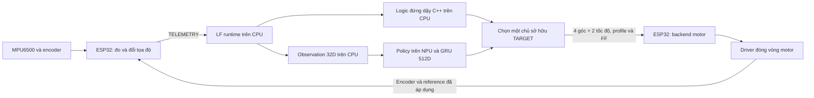

# Đối chiếu luồng hybrid LF–ESP32–motor — 2026-10-30

Lệnh motor từ LF là **4 góc target + 2 vận tốc bánh**, không có torque command.
Hai nhánh logic và policy dùng cùng contract này. Tài liệu này được đối chiếu
với mã nguồn, codec và các kiểm tra trong `reports/flow_audit_20261030/`.
Bản MCU có nội dung tương ứng tại `docs/audit-data-flow.md`.

## 0. Cập nhật sau audit: backend motor đã tích hợp

Theo yêu cầu tiếp theo, firmware HCR đã dùng `BlMotorBackend` + `EspBlMotor`;
không còn dùng stub trong target `esp32-s3-hybrid-mcu`. **UART2/GPIO15 là trái,
UART1/GPIO17 là phải**, theo đính chính cuối của người dùng. ID/chiều được đối
chiếu GUI/firmware BL4012e và file cài đặt invert=false. Có capture zero thủ công,
encoder unwrap/freshness, async batch ACK hai bus và OFF/TTL độc lập ở worker.
Xem [motor-integration.md](motor-integration.md). Test mới dùng backend/codec này
với mock bus và LF Core; các báo cáo HIL ở cuối tài liệu vẫn là bằng chứng đợt
trước tích hợp, không phải HIL với driver mới hoặc kiểm trên motor thật.

## 1. Những kết luận đã sửa

- Không suy ra LF gửi torque chỉ vì servo mô phỏng tính torque cho MuJoCo.
- Không kết luận wheel speed mode của BL4012 sai giao diện chỉ vì mô hình có
  torque cap. Đáp ứng thật có tương đương servo mô phỏng hay không vẫn cần đo.
- Không gọi crank target `phi` là knee hinge target. Nếu motor ID3 thực quay
  crank, nó nhận `phi_ref` sau đổi chiều/zero. Phép `phi-hip` dùng để lập feedback
  knee hinge; không tự gửi hiệu đó thay cho crank target.
- Torque Enable `0x18` là bật/tắt tạo lực. MIT `tau` trong driver là một trường
  của giao thức motor; nó không biến TARGET HCR1 thành torque command.
- Build/test phần mềm, HIL với plant giả lập và robot thật là các mức chứng cứ
  khác nhau. Backend BL4012e đã build/mock-test; chưa kiểm trên motor thật.

## 2. Các chương trình thực sự chạy



- `runtime.py`: transport, event loop, watchdog và status trên CPU LF.
- `hybrid/core.py`: chọn chủ sở hữu target, lịch model, handoff và fault.
- `hybrid/logic.py` + `native/logic_helper.cpp`: process C++ CPU, nhận sensor
  và tạo reference. Không gửi mô-men ra UART.
- `hybrid/policy.py`: tạo observation, normalize đúng backend, decode action
  trên CPU; `hybrid/rknn_backend.py` và `native/tensor_math.c` gọi RKNN NPU.
- MCU build `esp32-s3-hybrid-mcu`: `HybridGatewayApp/Core`, MPU6500 và
  `BlMotorBackend`/`EspBlMotor`. Không chạy app bench `BL4012e/3in1` hoặc
  firmware controller cũ; backend hiện link module bus từ bench, xem validation-bus-recovery.md.
- `BL4012e/3in1`: firmware ESP-IDF độc lập để điều khiển motor bằng GUI.
  App bench không được link vào HCR; riêng module joint_bus.c hiện được kế thừa và link.

`run_model.py` và `standup_bridge.cpp` ở gói controller gốc là đường mô phỏng.
Bridge đó có thể trả torque để ghi `MuJoCo.ctrl`. Không dùng giao diện bridge
mô phỏng để mô tả giao diện triển khai `native/logic_helper.cpp`/HCR1.
Gateway UDP LFG1 trong `LuckfoxGateway.*` cũng là bản nháp riêng, không phải HCR1.

## 3. Thứ tự kênh và đơn vị tại từng ranh giới

| Ranh giới | Dữ liệu | Đơn vị/ý nghĩa |
|---|---|---|
| TELEMETRY.q | hipL, hipR, kneeL, kneeR, wheelL, wheelR | rad, tọa độ MJCF đã homing; bánh unwrap |
| TELEMETRY.qd | cùng thứ tự q | rad/s |
| TARGET.target | hipL, hipR, phiL, phiR, omegaL, omegaR | 4 rad + 2 rad/s |
| TARGET.feedforward | hipL, hipR, kneeL, kneeR | 4 rad/s, knee hinge |
| TELEMETRY.applied_target | cùng thứ tự/ý nghĩa TARGET.target | reference đã áp dụng, không phải góc đo |
| Actor action | a0…a5 | 6 số chưa scale/offset; không có đơn vị motor |
| GRU hidden | 512 số | bộ nhớ LF, không gửi thành lệnh motor |
| Legacy core | LH, LK, LW, RH, RK, RW | khác thứ tự HCR; `coreToHcr()` chỉ đổi thứ tự |
| BL4012e mỗi leg | wheel ID1, knee/crank ID3, hip ID2 | thứ tự array: wheel, knee, hip |

Hai phần tử q[2:4] và target[2:4] **khác tọa độ**:

```text
phi_measured = góc crank motor đã đổi sign/zero
q_knee      = phi_measured - q_hip_measured
qd_knee     = phi_dot_measured - qd_hip_measured

phi_target  = target[2 hoặc 3]   # reference crank
knee_target_hình_học = phi_target - hip_target
phi_dot_ff  = hip_dot_ff + knee_dot_ff  # nếu driver cần crank feedforward
```

Ví dụ: hip=-0.5 rad, knee hinge=1.1 rad thì crank=0.6 rad. Encoder crank
0.6 rad phải tạo knee feedback 1.1 rad; nếu motor điều khiển crank thì target
crank 0.6 rad được gửi theo sign/offset của motor, không thay bằng 1.1 rad.

Các phép đổi đơn vị motor: `deg = rad*180/pi`,
`counts = rad*16384/(2*pi)` cho joint driver của gói 3in1,
`rpm = omega*60/(2*pi)` cho bánh. Các công thức này cần kết hợp sign/zero đã
hiệu chuẩn; người dùng đã chốt leg1/UART1 là phải, leg2/UART2 là trái.
10 rad/s = 95.492966 RPM trước ánh xạ chiều. Với encoder bánh modulo 1024,
1020→5 là +9 count nếu chuyển qua mốc theo chiều dương, không phải -1015.

## 4. Input actor và output policy

Actor chỉ dùng 32 observation sau, cộng hidden GRU 512D:

| Index obs | Nội dung |
|---|---|
| 0–2 | gyro body, rad/s |
| 3–5 | projected gravity body, unit vector |
| 6–8 | cmd_vx, 0, cmd_wz |
| 9–12 | q hipL/R,kneeL/R trừ default [-.7,-.7,.9,.9] |
| 13–18 | qd của cả sáu khớp |
| 19–24 | raw action trước; warm-up lấy từ applied_target được encode ngược |
| 25–27 | pose command cố định [0,0,.16] |
| 28–31 | jump command [0,0,0,0] |

Accel, hai hip torque và góc quay tuyệt đối bánh không nằm trong actor obs32.
Logic đứng dậy có dùng accel và có đường hip torque feedback tùy chọn.
Body convention là +X trước, +Y trái, +Z lên; gravity đứng thẳng [0,0,-1],
specific-force accel tĩnh [0,0,+9.81]. Trục trên board thật vẫn cần kiểm tra.

ONNX nhận raw obs vì normalizer đã nhúng trong graph. RKNN artifact hiện tại
nhận obs đã normalize bằng JSON mean/divisor bên ngoài. Không normalize hai lần.

`decode_actions()` trong `hybrid/policy.py` là ánh xạ cố định:

```text
hipL/R_ref = -0.7 + 0.25*a0/1         rad
phiL/R_ref =  0.2 + 0.25*a2/3         rad
omegaL/R_ref = (0.8/0.035)*a4/5       rad/s
```

0.035 là scale đã train; không thay bằng bán kính CAD 0.040 mà không đánh giá lại
controller. Các action không bị khóa trong [-1,1]; không thêm tanh hoặc clipping
theo quy ước của gateway UDP cũ. Giới hạn phần cứng cần được xử lý minh bạch
khi ghép driver và phản ánh đúng reference thực áp dụng.

## 5. HOME, đứng dậy, warm-up và handoff

1. Boot/reconnect: WAIT_LINK → bắt tay → DISARMED. Chỉ ARM khi telemetry mới,
   encoder/homing hợp lệ, pose gần home ±0.15 rad và driver ready.
2. HOME: giữ 3 s từ sample đầu sau ARM. Home feedback là
   [2.35706715,2.35706715,0,0]; home target gồm hai hip và hai phi đều 2.35706715.
3. Từ 3 s: C++ logic tạo target mỗi sample 5 ms. Phi target là hip+knee.
   `logic_helper.cpp` có 10-tick wheel delay = 50 ms trong nhánh recovery.
4. Từ 12.5 s: infer 100 Hz để warm-up GRU. Logic vẫn điều khiển;
   prediction warm-up chưa được gửi làm lệnh motor. `last_action` lấy từ
   applied_target đang thực hiện, không lấy prediction bị bỏ.
5. Sớm nhất 13 s, đã Support và có >=50 warm-up steps: prediction hợp lệ
   nhận quyền điều khiển, giữ GRU. Không reset hidden hoặc thêm output blending.
6. TARGET tiếp tục 200 Hz; policy chỉ đổi 100 Hz, giữ reference giữa hai lượt.
   HOME/POLICY gửi FF=0; RECOVERY gửi bốn joint-rate FF.

`Logic` pipe reply có 14 double: Support, phase, enables, target[6], ff[4], reserved.
Mô-men không có trong reply này. Servo fixture recovery có thêm wheel reference
filter tau=.075 s; không thêm lại 50 ms delay vào MCU. Cách tái tạo filter/servo
trên motor thật phải được chốt theo đáp ứng driver, không suy từ tần số task.

## 6. Wire, ACK và watchdog

- HCR1 LF–ESP32: UART full duplex 921600 baud 8N1. ESP TX43 → LF RX GPIO1_B3;
  ESP RX44 ← LF TX GPIO1_B2; GND chung. CP2102 đang dùng chung RX44 cần được
  xử lý theo sơ đồ board. Hai bus motor là UART1/DATA17 và UART2/DATA15,
  half duplex một dây 1 Mbaud; không trộn với đường LF.
- TARGET payload 52 B: epoch/source_seq/profile/enables, 6 target float,
  4 FF float. Tổng frame 76 B. Không có trường torque.
- TELEMETRY payload 128 B, tổng frame 152 B: flags, applied_seq và 29 float.
  Hai hip torque là feedback tùy chọn (generalized hip = hip_motor+crank_motor).
  Nếu chưa có dữ liệu đáng tin, gửi 0 và bỏ TORQUE_VALID. Không ảnh hưởng layout obs32.
- `applied_seq` chỉ cập nhật sau backend áp dụng reference, không sau nhận CRC
  và không chờ motor tới góc đích. `applied_target` phải là reference cuối cùng,
  gồm filter/limiter nếu có, không phải giá trị đo hay target chưa đưa tới servo.
- MCU TARGET TTL=20 ms từ lúc nhận; gói replay/cũ/queued quá hạn không gia hạn.
  Source phải trỏ tới telemetry đã gửi và còn mới <=30 ms.
- LF telemetry timeout=30 ms, target ACK timeout=30 ms. Inference >10 ms bỏ
  prediction/giữ reference; >15 ms hoặc 3 lần trễ liên tiếp gây fault.
- DISABLED bỏ enable; zero payload không phải lệnh quay về góc 0. Fault latch;
  DISARM/RESET là lệnh operator cục bộ trên LF, không đi trên HCR1. RESET tạo
  epoch mới rồi phải ARM lại. Reconnect không tự ARM.

Lưu ý: `mcu/hcr_link.h` là helper tham khảo tối giản, không phải state machine
đang dùng trên ESP32. Firmware hiện dùng `HybridGatewayCore.cpp` với target
enable gate, source history, sensor freshness, E-stop và transport queue. Không
thay GatewayCore bằng helper rồi coi các điều kiện bảo vệ là tương đương.

## 7. Gói bench BL4012e và những khác biệt khi ghép HCR

Code `3in1/src/main.c` hiện cấu hình:

| Leg | UART/DATA | ID1 wheel dir | ID3 knee/crank dir | ID2 hip dir |
|---|---|---:|---:|---:|
| leg1 | UART1/GPIO17 | -1 | +1 | -1 |
| leg2 | UART2/GPIO15 | +1 | -1 | +1 |

Các dấu này là quy ước GUI fold/forward trong gói 3in1, người dùng xác nhận đã
hiệu chuẩn trên motor; backend kế thừa chúng. Zero/model-coordinate vẫn cần
capture và kiểm bằng feedback thật. ID3 được xử lý là encoder crank của gói
hybrid. Chân trái là leg2/UART2, chân phải là leg1/UART1.

Các mục dưới mô tả app bench gốc, không phải các lỗi được giữ lại trong backend
HCR mới: `BlMotor.cpp` đã báo lỗi write/status, timestamp từng encoder, unwrap,
manual home, hai worker và ACK sau cả hai bus. Bench vẫn được giữ nguyên để
đối chiếu. Servo/gain/giới hạn lực trên robot chưa được xác minh.
`platformio.ini` đã sửa comment nhầm ID2/ID3 và nhầm bánh là MIT; cấu hình chạy giữ nguyên.

- Wheel dùng thanh ghi speed 0x20 (signed RPM), Torque Enable 0x18.
  Joint dùng MIT block Kp/Kd/position/RPM/tau; `joint_cycle()` hiện gửi tau=0.
- `leg_move()` là delta góc cộng vào target cũ; `step_position()` tự sinh
  trajectory, giới hạn tốc độ/gia tốc và lag guard 15°. HCR gửi góc tuyệt đối;
  không gọi leg_move(target) hoặc tự cộng thêm trajectory mà coi là cùng reference.
- Joint min/max hiện là +/-719 độ của dải driver, chưa phải giới hạn cơ khí
  thật. Lag guard 15 độ không thay cho giới hạn hành trình được hiệu chuẩn.
- Parser console bench dùng sscanf float chưa loại NaN/Inf trước đổi sang
  số nguyên hoặc target. HCR codec hiện đã chặn nonfinite; không nhập nguyên
  parser bench vào đường HCR rồi bỏ kiểm tra này.
- Wheel có accel limit 600 RPM/s và write/read luân phiên, nên nominal speed
  write mỗi 8 ms khi leg cycle đạt 4 ms. Đây là giới hạn thêm so với đầu vào HCR.
- **Lỗi/reporting còn mở:** `wheel_write_speed()` nuốt lỗi trả về của bus;
  `wheel_cycle()` trả ESP_OK sau lần write đó. `note_status()` cũng reset miss
  streak sau write ACK, nên không thể dùng configured/online để khẳng định
  position/speed feedback còn mới. Cần timestamp riêng và truyền lỗi chính xác
  trước khi backend báo applied/encoder-valid.
- Bus transaction blocking, joint RX timeout 2 ms, wheel RX timeout 6 ms;
  chu kỳ 4 ms không được bảo đảm. Không gọi I/O này trực tiếp vào service HCR
  nonblocking 500 us. Cần bus worker/state machine có deadline.
- API trước tích hợp chỉ có bool. API hiện tại là Pending/Applied/Fault và
  MotorApplied chứa epoch/sequence riêng; không trả Applied khi mới enqueue.
  `disable()` yêu cầu hủy, `disabled()` xác nhận OFF. Có regression test cả hai.
- Feedback hiện là driver-frame degrees/RPM, bánh chỉ một vòng, không có
  homing/unwrap hoặc timestamp riêng từng encoder trong public view.
- Firmware joint default Kp=10,Kd=.036; GUI tự gửi Kp=10,Kd=.7 khi motor online,
  sau đó firmware cap theo giới hạn đọc từ driver. Không coi .036 là gain thực
  đang dùng khi GUI đã kết nối. Không áp gain mô phỏng 30/1 mà chưa đối chiếu driver.
- Wheel cap 950 RPM là trần command hiện có của gói, không phải rated continuous
  speed 400 RPM. HCR không tự suy ra giới hạn vận hành từ tên motor.
- Host GUI timeout 1 s chỉ halt wheel/jog; không thay TTL 20 ms/disable của HCR.
- 3in1 build dùng board generic N8, sdkconfig flash 2 MB và không PSRAM;
  build cảnh báo flash-size mismatch. Bản hybrid đích là N16R8 và toolchain
  Arduino khác ESP-IDF 5.5 của 3in1. Chưa thể chép nguyên app_main/gui UART0
  115200 vào HCR UART0 921600 đang dành cho LF.
- Tài liệu HTML driver joint mục 7.1 ghi sai checksum TX của MIT example:
  `FF FF 01 0D 03 1A 10 27 24 00 00 10 00 00 00 00` phải kết thúc bằng
  **69**, không phải 64. `joint_bus.c` tính đúng theo công thức checksum của
  chính tài liệu. `BL4012e/tests/check_motor_bus.py` biên dịch code thực với
  UART/GPIO mock và kiểm tra vector này, read/write wheel, offset phản hồi,
  echo, timeout và checksum. Đây vẫn là test codec, không phải bus điện thật.

## 8. Chứng cứ và phần còn chưa xác minh

Kết quả chạy lại và exact commands nằm trong
`reports/flow_audit_20261030/SUMMARY.md` và các log/JSON cùng thư mục.
Các mức chứng cứ được tách riêng: hash/source, build, unit/contract tests,
ONNX CPU reference, RKNN trên LF và HIL MuJoCo qua SSH.

HIL dùng sensor/servo giả lập và timestamp mô phỏng, bỏ qua UART vật lý, MCU app,
driver thật và lease console. PASS HIL không chứng minh jitter bus, homing,
chiều motor, gain/torque limit hoặc cân bằng trên robot thật.

LF đang chạy service WAIT_LINK với Unix transport. Nguồn triển khai khớp local
trước audit, nhưng filesystem gốc LF hiện read-only. Bản audit được stage tại
`/tmp/hcr-flow-audit-20261030` để kiểm tra; tài liệu/source cập nhật bền vững
được giữ trên máy phát triển. Chưa cập nhật bền vững thư mục runtime gốc trên LF.
Ở lần đọc trạng thái cuối, `/dev/ttyS2` tồn tại và không thấy process giữ cổng;
điều này không chứng minh pinmux/dây UART hoạt động. Không có phiên motor thật
hoặc firmware upload nào được thực hiện trong đợt audit này.

## 9. Quy tắc cho các lần giải thích/thay đổi sau

1. Trước khi mô tả input/output, kiểm tra producer, payload codec và consumer.
2. Ghi rõ measured/target/FF, thứ tự, đơn vị, frame và nơi đổi sign/zero.
3. Phân biệt mô-men nội bộ plant, optional torque feedback và Torque Enable.
4. Mọi thay đổi mapping phải có test kênh khác nhau ở mỗi vị trí, không chỉ
   roundtrip bằng hai hàm có thể cùng sai; không tự đổi scale/offset/trained clip.
5. Không khẳng định đã ghép/đã chạy trên robot từ một build, stub, mock hoặc HIL.
