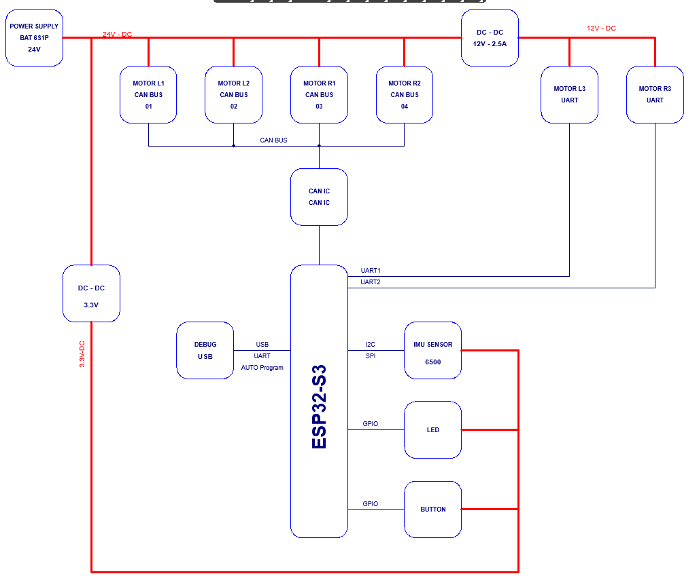

# POC \- Robot version 1

## Yêu cầu kỹ thuật chung

Ngày : 11/09/2026

HW bao gồm các thành phần 

1. Số lượng động cơ support can bus 4  \- hoạt động 24V

2. số lượng động cơ support uart 2 \- hoạt động 12V 

3. Sử dụng pin 6S1P sạc ngoài

4. sử dụng esp32\-S3 có cổng debug và led

5. sử dụng IMU 6500 \- thêm một số mẫu khác

6. mục tiêu sản phẩm mẫu hoàn thành 25/09 =\> HW cần sớm hơn 3 ngày

## Kiến trúc tổng thể

Hệ thống được chia thành 6 khối:

- Nguồn và bảo vệ pin\. 

- Bộ xử lý trung tâm ESP32\-S3\. 

- Giao tiếp BLE với điện thoại\. 

- Mạng CAN điều khiển 4 động cơ 24 V\. 

- Hai kênh UART điều khiển 2 động cơ 12 V\. 

- IMU phục vụ cân bằng và xác định tư thế robot\. 

## Phân bổ động cơ

Mỗi động cơ CAN phải có một Node ID riêng, ví dụ:

CAN ID chính thức phải điều chỉnh theo protocol của nhà sản xuất động cơ\.

## Kiến trúc nguồn

Pin 6S1P có:

- Điện áp danh định: 22,2 V\. 

- Điện áp sạc đầy: 25,2 V\. 

- Điện áp thấp phụ thuộc loại cell và ngưỡng BMS\. 

- Không nên mặc định động cơ “24 V” chịu được 25,2 V nếu chưa kiểm tra datasheet\. 

### Các đường nguồn đề xuất

Công suất buck 12 V cần tính lại theo dòng khởi động hoặc dòng kẹt trục thực tế\. Hai động cơ có dòng danh định tổng cộng 2 A nhưng bộ nguồn 12 V không nên chỉ thiết kế đúng 2 A\.

## Khối ESP32\-S3

Khuyến nghị sử dụng module ESP32\-S3\-WROOM\-1 thay vì chip rời để:

- Giảm rủi ro thiết kế RF\. 

- Có sẵn Flash và tùy chọn PSRAM\. 

- Dễ chứng nhận và sản xuất\. 

- Rút ngắn thời gian phát triển\. 

### Chức năng của ESP32\-S3

- Nhận lệnh điều khiển từ điện thoại qua BLE\. 

- Đọc MPU\-6050 và tính toán tư thế robot\. 

- Gửi lệnh vị trí, tốc độ hoặc mô\-men cho động cơ CAN\. 

- Điều khiển hai động cơ UART\. 

- Thu thập trạng thái, lỗi và vị trí động cơ\. 

- Giám sát pin, nguồn và nhiệt độ\. 

- Thực hiện bảo vệ và dừng khẩn cấp\. 

- Hỗ trợ cập nhật firmware\. 

## Khối CAN

ESP32\-S3 có bộ điều khiển TWAI tương thích CAN 2\.0 nhưng vẫn cần một CAN transceiver bên ngoài\.

### Linh kiện gợi ý

- CAN transceiver: TCAN332, SN65HVD230 hoặc tương đương\. 

- Bảo vệ ESD/TVS chuyên dụng cho CAN\. 

- Điện trở kết thúc bus 120 Ω có jumper hoặc DIP switch\. 

- Common\-mode choke nếu dây dài hoặc môi trường nhiễu mạnh\. 

- Điện trở series nhỏ trên TX/RX phục vụ kiểm soát EMI\. 

- Đầu nối tối thiểu 4 chân: VBAT, GND, CAN\-H, CAN\-L\. 

### Topology CAN

Nên dùng bus dạng đường thẳng, hạn chế đấu hình sao:

Nếu kết cấu robot bắt buộc rẽ nhánh sang hai chân, chiều dài nhánh phải ngắn và cần kiểm tra tín hiệu thực tế bằng oscilloscope\.

## Hai kênh UART

Hai động cơ UART dùng hai bộ UART độc lập:

Trước khi chốt mạch cần xác nhận UART của động cơ là:

- Logic 3,3 V\. 

- Logic 5 V TTL\. 

- RS\-232\. 

- RS\-485 hoặc UART vi sai\. 

Nếu động cơ dùng logic 5 V, RX của ESP32\-S3 phải được chuyển mức xuống 3,3 V\. Không được đưa trực tiếp tín hiệu 5 V vào GPIO của ESP32\-S3\.

## Khối MPU\-6050

MPU\-6050 hỗ trợ I²C, không hỗ trợ I²S\.

### Yêu cầu thiết kế

- Điện trở pull\-up SDA và SCL: khoảng 2,2–4,7 kΩ\. 

- Kết nối chân INT vào GPIO có khả năng ngắt\. 

- Tụ 100 nF đặt sát chân nguồn\. 

- Tách IMU khỏi vùng buck converter, cuộn cảm và đường dòng động cơ\. 

- Đặt IMU gần tâm thân robot\. 

- Ghi rõ hướng trục X/Y/Z trên silkscreen PCB\. 

- Bố trí PCB chắc chắn, giảm rung cơ học\. 

- Có thể bổ sung EEPROM lưu dữ liệu hiệu chuẩn\. 

## Debug, nạp chương trình và giao diện người dùng

### Cổng debug đề xuất

USB\-C cần có:

- Hai điện trở 5,1 kΩ tại CC1 và CC2\. 

- TVS chống ESD cho D\+ và D−\. 

- Cầu chì tự phục hồi hoặc load switch trên VBUS\. 

- Không để nguồn USB cấp ngược sang đường công suất robot\. 

### Nút nhấn và LED

## Phân bổ ngoại vi ESP32\-S3

Đây là phân bổ chức năng sơ bộ; GPIO cụ thể cần chốt sau khi chọn module và kiểm tra các chân boot/strapping\.

|Nhóm|Chức năng|Chân ESP32\-S3|Hướng|Mức hoạt động / cấu hình|
|---|---|---|---|---|
|Input|Button|GPIO6|Input|Nhấn = LOW, nhả = HIGH; active\-low|
|LED|LED1|GPIO39|Output|HIGH = sáng, LOW = tắt|
|LED|LED2|GPIO40|Output|HIGH = sáng, LOW = tắt|
|LED|LED3|GPIO41|Output|HIGH = sáng, LOW = tắt|
|Dự phòng|Spare GPIO|GPIO42|Chưa cấu hình|Để trống, có test point|
|USB native|USB D−|GPIO19|USB|Không dùng như GPIO thường|
|USB native|USB D\+|GPIO20|USB|Không dùng như GPIO thường|
|UART0 / CP2102|ESP32 UART0 TX|GPIO43|Output|Nối RXD của CP2102|
|UART0 / CP2102|ESP32 UART0 RX|GPIO44|Input|Nối TXD của CP2102|
|Auto\-program|Boot|GPIO0|Input/strap|Điều khiển từ DTR/RTS qua mạch transistor|
|Auto\-program|Reset|EN|Input|Điều khiển từ DTR/RTS qua mạch transistor|
|Motor UART1|TX|GPIO17|Output|1 Mbaud, 8N1|
|Motor UART1|RX|GPIO18|Input|1 Mbaud, 8N1|
|Motor UART2|TX|GPIO15|Output|1 Mbaud, 8N1|
|Motor UART2|RX|GPIO16|Input|1 Mbaud, 8N1|
|CAN/TWAI|CAN TX|GPIO4|Output|Nối TXD của CAN transceiver|
|CAN/TWAI|CAN RX|GPIO5|Input|Nối RXD của CAN transceiver|
|Sensor I²C|SDA|GPIO8|I/O open\-drain|Cần điện trở kéo lên 3,3 V|
|Sensor I²C|SCL|GPIO9|Output open\-drain|Cần điện trở kéo lên 3,3 V|
|MPU6500 SPI|CS|GPIO10|Output|Active\-low|
|MPU6500 SPI|MOSI|GPIO11|Output|SPI master data out|
|MPU6500 SPI|SCLK|GPIO12|Output|SPI clock|
|MPU6500 SPI|MISO|GPIO13|Input|SPI master data in|
|MPU6500|INT|GPIO14|Input|Ngắt cảm biến, tùy chọn|

## Kiến trúc bo mạch đề xuất

Để giảm nhiễu và thuận tiện phát triển, nên chia thành:

- Main Controller Board: ESP32\-S3, BLE, CAN, UART, IMU, USB và debug\. 

- Power Distribution Board: đầu vào pin, bảo vệ, đo dòng, buck 12 V, buck 5 V và phân phối nguồn động cơ\. 

- Emergency Stop: mạch riêng hoặc đường phần cứng độc lập để ngắt enable/công suất động cơ\. 

Cách chia này đặc biệt phù hợp vì dòng động cơ lớn có thể gây sụt áp và nhiễu, ảnh hưởng đến ESP32\-S3 và IMU\. Kiến trúc hiện tại đủ để chuyển sang bước tiếp theo: chọn linh kiện, tính nguồn, lập bảng GPIO và thiết kế schematic chi tiết\.

## Thiết kế mạch phần cứng

### 11\.1 Sơ đồ khối 

### 11\.2 Nguyên lý pdf

**Change log**

- 16/09 : xuất bản phiên bản đầu tiên=\>  thực hiện kiểm tra với team SW

- 16/09 cập nhật lại pin ESP32 điều chỉnh chân led và nút nhấn

[R1\-POC\-V1\.0\.PDF](Images_attachments/R1-POC-V1.0.PDF)

### 11\.3 Layout pcb

|Dxf file|[pcb robot OK\.dxf](Images_attachments/pcb%20robot%20OK.dxf)|Ngày 15/09 : dxf file pcb thiết kế Ngày 16/06 dxf update lại|
|---|---|---|
|PCB|||
|Design Project|||

### 11\.4 Checklist thiết kế

#### **Thông tin thiết kế**

|Hạng mục|Giá trị|
|---|---|
|MCU/module|ESP32\-S3\-WROOM\-1\-N16R8|
|Nguồn chính|Pin Li\-ion 6S1P|
|Điện áp pin danh định|22,2 V|
|Điện áp pin cực đại|25,2 V|
|Nguồn động cơ CAN|Theo thông số động cơ 24 V|
|Nguồn động cơ UART|12 V|
|Nguồn logic|3,3 V|
|Giao tiếp PC|CP2102 → UART0|
|USB native dự phòng|GPIO19/GPIO20|
|CAN|ESP32\-S3 TWAI \+ transceiver ngoài|
|Cảm biến|MPU6050, MPU6500 hoặc LSM303DLHC|

#### **Checklist mapping chân**

|☐|Chức năng|ESP32\-S3|Yêu cầu kiểm tra|
|---|---|---|---|
|PASS|Button|GPIO6|Active\-low; không xung đột ngoại vi|
|PASS|LED1|GPIO39|HIGH sáng|
|PASS|LED2|GPIO40|HIGH sáng|
|PASS|LED3|GPIO41|HIGH sáng|
|PASS|GPIO dự phòng|GPIO42|Đưa ra test point; mặc định input|
|PASS|UART1 TX|GPIO17|Động cơ 1; 1 Mbaud|
|PASS|UART1 RX|GPIO18|Kiểm tra mức điện áp UART|
|PASS|UART2 TX|GPIO15|Động cơ 2; 1 Mbaud|
|PASS|UART2 RX|GPIO16|Kiểm tra mức điện áp UART|
|PASS|CAN TX|GPIO4|Nối TXD của transceiver|
|PASS|CAN RX|GPIO5|Nối RXD của transceiver|
|PASS|I²C SDA|GPIO8|Có pull\-up 3,3 V|
|PASS|I²C SCL|GPIO9|Có pull\-up 3,3 V|
|PASS|MPU6500 SPI CS|GPIO10|Active\-low|
|PASS|MPU6500 SPI MOSI|GPIO11|ESP32 → cảm biến|
|PASS|MPU6500 SPI SCLK|GPIO12|Kiểm soát trở kháng/độ dài|
|PASS|MPU6500 SPI MISO|GPIO13|Cảm biến → ESP32|
|PASS|IMU INT|GPIO14|Kiểm tra cực tính ngắt|
|PASS|USB native D−|GPIO19|Không nối chung trực tiếp với CP2102|
|PASS|USB native D\+|GPIO20|Không nối chung trực tiếp với CP2102|
|PASS|UART0 TX|GPIO43|Nối RXD CP2102|
|PASS|UART0 RX|GPIO44|Nối TXD CP2102|
|PASS|Boot|GPIO0|Pull\-up và mạch auto\-program|
|PASS|Reset|EN|RC reset và auto\-program|
|PASS|PSRAM/Flash|GPIO26–37|Không sử dụng làm ngoại vi|
|PASS|Strapping|GPIO0/45/46|Không bị ngoại vi ép sai mức lúc reset|

#### **Checklist nguyên lý nguồn**

|Mức|☐|Nội dung kiểm tra|Tiêu chí đạt|
|---|---|---|---|
|Bắt buộc|PASS|Điện áp đầu vào được thiết kế cho pin 6S đầy|Chịu ít nhất 25,2 V và có dự phòng phù hợp|
|Bắt buộc|PASS|Bảo vệ ngược cực|MOSFET hoặc diode phù hợp dòng tải|
|Bắt buộc|Không cần|Cầu chì hoặc polyfuse đầu vào|Định mức theo dòng cực đại|
|Bắt buộc|PASS|TVS đầu vào|Điện áp TVS phù hợp đường nguồn 6S|
|Bắt buộc|Không sử dụng|Công tắc nguồn chịu đủ dòng|Không đưa dòng động cơ qua công tắc tín hiệu nhỏ|
|Bắt buộc|PASS 12V 2\.5A|Bộ nguồn 12 V|Đủ dòng cho hai động cơ UART và dòng khởi động|
|Bắt buộc|PASS 3\.3V 1A|Bộ nguồn 3,3 V|Đủ dòng ESP32\-S3, RF, IMU, CAN và LED|
|Bắt buộc|PASS có tụ chống sụt áp|Dòng đỉnh Wi\-Fi/Bluetooth|Nguồn 3,3 V không sụt áp gây reset|
|PASS|Tụ đầu vào DC\-DC |Theo datasheet, đúng điện áp định mức||
|PASS|Tụ bulk tại đầu nối động cơ |Giảm sụt áp và xung dòng||
|PASS|Tụ 100 nF tại IC |Đặt cho từng chân nguồn IC||
|PASS|Tụ 10–47 µF gần ESP32 |Giảm sụt áp khi RF phát||
|Không sử dụng|Power\-good hoặc đo nguồn |Có test point hoặc ADC nếu cần||
|PASS|Phân vùng nguồn|Logic, motor và USB được xác định rõ||
|PASS|GND chung |Không để đường hồi dòng động cơ đi qua vùng IMU/ESP32||
|PASS|Nhiệt độ DC\-DC|Có tính tổn hao và nhiệt độ tại tải cực đại||
|PASS|Khoảng cách điện|Đáp ứng điện áp và yêu cầu sản xuất||

#### **Checklist ESP32\-S3**

|Mức|☐|Nội dung kiểm tra|Tiêu chí đạt|
|---|---|---|---|
|Bắt buộc|PASS|Xác nhận đúng module N16R8|BOM, footprint và firmware thống nhất|
|Bắt buộc|PASS|EN có pull\-up|Thường 10 kΩ lên 3,3 V|
|Bắt buộc|PASS|EN có tụ reset|Giá trị theo khuyến nghị Espressif|
|Bắt buộc|PASS|GPIO0 có pull\-up|Boot bình thường khi không nạp|
|Bắt buộc|PASS|GPIO45/GPIO46|Không bị ép sai mức lúc khởi động|
|Bắt buộc|PASS|GPIO26–37|Không nối ngoại vi trên bản N16R8|
|PASS|Tụ decoupling module|Đặt sát chân 3,3 V/GND||
|PASS|Test point EN/GPIO0|Dễ debug và phục hồi board||
|PASS|UART0 test point|TX, RX và GND có thể đo||
|PASS|Header debug|Có 3V3, GND, TX, RX, EN, GPIO0||
|PASS|Antenna keepout|Không đồng, linh kiện hoặc plane dưới vùng antenna||
|PASS|Vị trí module|Antenna gần mép PCB, hướng ra ngoài||
|PASS|Vỏ máy|Kim loại và dây nguồn không che antenna||

#### Checklist USB\-C, CP2102 và auto\-program

|Mức|☐|Nội dung kiểm tra|Tiêu chí đạt|
|---|---|---|---|
|Bắt buộc|PASS|Xác định topology USB|CP2102 hoặc native USB; không nối song song trực tiếp|
|Bắt buộc|PASS|USB\-C CC1/CC2|Mỗi chân có điện trở Rd 5,1 kΩ xuống GND khi là device|
|Bắt buộc|PASS|D\+/D− tới CP2102|Đúng cực, không đảo|
|Bắt buộc|PASS|CP2102 TX → GPIO44|UART0 RX của ESP32|
|Bắt buộc|PASS|CP2102 RX ← GPIO43|UART0 TX của ESP32|
|Bắt buộc|PASS|DTR/RTS auto\-program|Qua mạch transistor tới GPIO0 và EN|
|Bắt buộc|PASS|Kiểm tra trạng thái DTR/RTS|Không giữ ESP32 reset khi mở cổng COM|
|Bản POC chưa cần|USB ESD|Diode ESD điện dung thấp gần đầu nối||
|Bản POC chưa cần|VBUS bảo vệ|Có fuse/giới hạn dòng nếu dùng nguồn USB||
|PASS|Chống cấp nguồn ngược|USB 5 V không back\-feed vào DC\-DC||
|PASS|Shield USB|Nối chassis/GND theo chiến lược EMC||
|Không sử dụng|Điện trở nối tiếp USB|Chỉ dùng nếu reference design/đo kiểm yêu cầu||
|PASS|Native USB|GPIO19/20 để NC hoặc qua mux đúng chuẩn||
|PASS|Nhãn cổng|Phân biệt USB\-UART và USB\-native nếu có hai cổng||

#### Checklist button và LED

|☐|Nội dung kiểm tra|Tiêu chí đạt|
|---|---|---|
|PASS|Button nối GPIO6|Nhấn kéo xuống GND|
|PASS|Pull\-up button|Có pull\-up ngoài khoảng 10 kΩ hoặc xác nhận pull\-up nội|
|PASS|Lọc nhiễu button|Có thể dùng RC nhỏ và debounce phần mềm|
|Không sử dụng|ESD button|Bổ sung nếu button hoặc dây đi ra ngoài vỏ|
|PASS|LED1 GPIO39|Điện trở hạn dòng riêng|
|PASS|LED2 GPIO40|Điện trở hạn dòng riêng|
|PASS|LED3 GPIO41|Điện trở hạn dòng riêng|
|PASS|Dòng GPIO|Trong giới hạn ESP32 và không gây tải nguồn quá mức|
|PASS|Trạng thái boot|LED không sáng ngoài ý muốn khi khởi động|
|PASS|GPIO42|Có test point, không kéo cứng lên/xuống nếu chưa dùng|

#### Checklist cảm biến IMU

|Mức|☐|Nội dung kiểm tra|Tiêu chí đạt|
|---|---|---|---|
|Bắt buộc|PASS|Điện áp cảm biến|IC/module tương thích mức 3,3 V|
|Bắt buộc|PASS|MPU6050 AD0|Kéo lên 3,3 V; địa chỉ 0x69|
|Bắt buộc|PASS|MPU6500 AD0|Kéo xuống GND; địa chỉ I²C 0x68|
|Bắt buộc|PASS|Chọn I²C/SPI MPU6500|Jumper hoặc điện trở 0 Ω có trạng thái rõ ràng|
|Bắt buộc|PASS|CS MPU6500|Không để floating|
|PASS điện trở 10K|SDA/SCL pull\-up|Thường 2,2–4,7 kΩ; tính theo điện dung bus||
|PASS|LSM303DLHC accelerometer|Kiểm tra địa chỉ 0x19 theo cấu hình SA0||
|PASS|LSM303DLHC magnetometer|Kiểm tra địa chỉ 0x1E||
|PASS|Tụ decoupling|100 nF và tụ bulk theo datasheet||
|PASS pull up|INT GPIO14|Pull\-up/down đúng kiểu ngõ ra||
|PASS|Test point bus|SDA, SCL, SCLK, MOSI, MISO, CS, INT||
|PASS|Lựa chọn cảm biến|Không để nhiều IC cùng lái chung MISO||
|PASS \- bổ xung trên module|Hướng trục|Có ký hiệu X/Y/Z trên silkscreen||
|PASS|Vị trí IMU|Xa DC\-DC, cuộn cảm, motor và cạnh PCB rung mạnh||
|PASS|LSM303 từ kế|Xa dây dòng lớn, nam châm, cuộn cảm và vùng đồng dòng cao||

#### Checklist UART động cơ

|Mức|☐|Nội dung kiểm tra|Tiêu chí đạt|
|---|---|---|---|
|Bắt buộc|PASS|Mức điện áp UART board ngoài|Xác nhận là 3,3 V; thêm chuyển mức nếu khác|
|Bắt buộc|PASS|UART1 TX/RX|GPIO17/GPIO18, không đảo|
|Bắt buộc|PASS|UART2 TX/RX|GPIO15/GPIO16, không đảo|
|Bắt buộc|PASS|GND tham chiếu|GND giữa hai board được nối đúng|
|PASS |Tốc độ 1 Mbaud|Đường ngắn, ít stub, đầu nối phù hợp||
|PASS \- mạch để trở 0R thay đổi theo thực tế|Điện trở series|Dự phòng 22–47 Ω gần chân TX||
|PASS|ESD|Có nếu cáp đi ra ngoài PCB||
|PASS|Đầu nối|Có khóa hướng và định danh TX/RX/GND/12 V||
|PASS|Trạng thái mất nguồn|Board ngoài không cấp ngược qua TX/RX||
|PASS|Test point|TX/RX cho từng UART||
|PASS|Đường 12 V|Không đi sát hoặc song song dài với RX/TX||

#### Checklist CAN

|Mức|☐|Nội dung kiểm tra|Tiêu chí đạt|
|---|---|---|---|
|Bắt buộc|PASS|Transceiver CAN|Tương thích logic 3,3 V và điện áp bus|
|Bắt buộc|PASS|TX/RX|GPIO4/GPIO5 đúng chiều|
|Bắt buộc|PASS|CANH/CANL|Không đảo|
|Bắt buộc|PASS|Termination|120 Ω chỉ lắp ở hai đầu bus|
|PASS|Điện trở termination|Có jumper/DNP nếu bo không luôn nằm cuối bus||
|PASS \- không sử dụng tụ|Split termination|Có thể dùng 2 × 60 Ω và tụ nếu cần EMC||
|PASS|TVS CAN|TVS chuyên dụng đặt sát đầu nối||
|Không sử dụng|Common\-mode choke|Dự phòng footprint nếu môi trường nhiễu||
|PASS|CAN standby/silent|Chân không để floating||
|PASS|GND bus|Có chân GND tham chiếu tại đầu nối||
|Không sử dụng|Shield/chassis|Có chiến lược nối shield nếu dùng cáp shield||
|PASS|Test point|CANH, CANL, TXD, RXD||
|Check thực tế|Tốc độ mục tiêu|Layout đáp ứng tới 1 Mbit/s||
|PASS |Đầu nối|Có khóa hướng, nhãn CANH/CANL/GND||

#### Checklist layout nguồn và dòng lớn

|Mức|☐|Nội dung kiểm tra|Tiêu chí đạt|
|---|---|---|---|
|Bắt buộc|PASS|Chiều rộng đường nguồn|Tính theo dòng liên tục, nhiệt độ và độ dày đồng|
|Bắt buộc|PASS|Dòng khởi động motor|Đường mạch, đầu nối và DC\-DC chịu được dòng đỉnh|
|Bắt buộc|PASS |Vòng dòng switching|Diện tích nhỏ theo reference layout DC\-DC|
|Bắt buộc|PASS|Dòng hồi motor|Không chạy qua GND IMU/ESP32|
|PASS|Polygon nguồn|Không tạo cổ chai tại pad/via||
|PASS|Via dòng lớn|Dùng đủ số lượng và đường kính via||
|PASS|Tản nhiệt|Có copper pour và thermal via dưới IC nguồn||
|PASS|Tụ bulk|Đặt gần đầu nối tải||
|PASS|Feedback DC\-DC|Xa node switching và đường dòng lớn||
|PASS |Test point nguồn|BAT\+, 12 V, 5 V nếu có, 3V3 và GND||
|PASS|Khoảng hở mép board|Đầu vào pin không quá sát cạnh hoặc lỗ vít||
|PASS|Nhiệt|Không đặt IMU sát DC\-DC hoặc linh kiện nóng||

#### Checklist layout tín hiệu

|Mức|☐|Nội dung kiểm tra|Tiêu chí đạt|
|---|---|---|---|
|Bắt buộc|PASS|Ground plane|Liên tục dưới MCU và tín hiệu số|
|Bắt buộc|PASS|USB D\+/D−|Cặp vi sai, cùng lớp, ít via, chiều dài tương đương|
|Bắt buộc|PASS|CANH/CANL|Cặp vi sai, khoảng cách ổn định, ít stub|
|☐PASS|SPI clock|Ngắn, có ground reference liên tục||
|PASS|I²C|Ngắn, tránh node switching||
|PASS|UART 1 Mbaud|Tránh chạy sát đường nguồn motor||
|PASS|Không cắt plane|Không đi tín hiệu tốc độ cao qua khe ground||
|PASS|Via stitching|Bổ sung quanh biên board và vùng nhiễu||
|PASS|Crystal/antenna|Tuân thủ keepout của module||
|PASS|Góc đường mạch|Dùng góc 45° hoặc cung; tránh nhánh stub dài||
|PASS|Khoảng cách connector|TVS đặt trước khi tín hiệu đi sâu vào PCB||
|PASS|Test point|Không tạo stub quá dài trên USB/CAN/SPI||

#### Checklist vị trí linh kiện

|☐|Nội dung kiểm tra|Tiêu chí đạt|
|---|---|---|
|PASS|ESP32 ở cạnh PCB|Antenna hướng ra ngoài|
|PASS|Không đồng dưới antenna|Tất cả các lớp tuân thủ keepout|
|PASS|IMU gần tâm cơ khí|Giảm ảnh hưởng rung và gia tốc quay|
|PASS|IMU đúng hướng|Ký hiệu trục trùng tài liệu firmware|
|PASS|Từ kế cách xa nguồn nhiễu|Không gần motor, cuộn cảm, dây pin, nam châm|
|PASS|CAN transceiver gần đầu nối|CANH/CANL ngắn trước TVS/connector|
|PASS|CP2102 gần USB|D\+/D− ngắn|
|PASS|DC\-DC gần tải/đầu vào phù hợp|Vòng dòng nhỏ|
|PASS|Đầu nối có khoảng thao tác|Không bị linh kiện cao cản trở|
|PASS|LED quan sát được|Không bị che bởi module hoặc vỏ|
|PASS|Button thao tác được|Đúng vị trí cơ khí vỏ máy|
|PASS|Linh kiện phân cực|Có dấu pin 1, cực diode và cực tụ|

#### Checklist DRC, ERC và sản xuất

|Mức|☐|Nội dung kiểm tra|Tiêu chí đạt|
|---|---|---|---|
|Bắt buộc|☐|ERC schematic|Không còn lỗi nguồn/input/output chưa xử lý|
|Bắt buộc|☐|DRC PCB|Không còn lỗi clearance, short hoặc unconnected|
|Bắt buộc|☐|Netlist schematic–PCB|Đồng nhất hoàn toàn|
|Bắt buộc|☐|Footprint module|Đúng ESP32\-S3\-WROOM\-1|
|Bắt buộc|☐|Footprint connector|Đúng mã linh kiện và hướng cắm|
|☐|BOM|Có MPN, package, tolerance, voltage/current rating||
|☐|Linh kiện DNP|Ghi rõ trên BOM và assembly drawing||
|☐|Fiducial|Có global fiducial và local nếu cần||
|☐|Tooling hole|Theo yêu cầu nhà sản xuất||
|☐|Solder mask|Không che pad và test point||
|☐|Silkscreen|Không đè lên pad||
|☐|Pin 1 marking|Rõ ràng cho IC và connector||
|☐|Panelization|Đáp ứng vị trí connector/antenna||
|☐|Gerber review|Kiểm tra bằng viewer độc lập||
|☐|Pick\-and\-place|Kiểm tra rotation và origin||
|☐|3D review|Không va chạm vỏ, connector hoặc heatsink||

#### Checklist test point và bring\-up

|☐|Test point cần có|Mục đích|
|---|---|---|
|☐|BAT\+ và GND|Kiểm tra đầu vào|
|☐|12 V|Kiểm tra nguồn động cơ UART|
|☐|3V3|Kiểm tra logic|
|☐|EN|Reset/debug|
|☐|GPIO0|Download mode|
|☐|UART0 TX/RX|Flash và log|
|☐|GPIO6|Kiểm tra button|
|☐|GPIO39/40/41|Kiểm tra LED|
|☐|GPIO42|GPIO dự phòng|
|☐|SDA/SCL|Debug I²C|
|☐|SCLK/MOSI/MISO/CS|Debug MPU6500 SPI|
|☐|UART1 TX/RX|Debug động cơ 1|
|☐|UART2 TX/RX|Debug động cơ 2|
|☐|CAN TXD/RXD|Debug phía logic|
|☐|CANH/CANL|Đo bus|
|☐|GND cạnh từng nhóm|Kẹp oscilloscope thuận tiện|

#### Checklist nghiệm thu nguyên mẫu

|☐|Bước kiểm tra|Tiêu chí đạt|
|---|---|---|
|☐|Kiểm tra short trước cấp nguồn|Không short BAT, 12 V hoặc 3V3 với GND|
|☐|Cấp nguồn giới hạn dòng|Không có dòng bất thường|
|☐|Đo 3,3 V|Trong dung sai thiết kế|
|☐|Đo 12 V|Trong dung sai thiết kế|
|☐|Kiểm tra ripple nguồn|Không vượt giới hạn đặt ra|
|☐|Flash qua CP2102|Auto\-reset và download hoạt động|
|☐|Kiểm tra boot log|Không brownout/reset lặp|
|☐|Test button GPIO6|Nhấn LOW, nhả HIGH|
|☐|Test ba LED|Đúng thứ tự và cực tính|
|☐|Scan I²C|Phát hiện đúng cảm biến được lắp|
|☐|Test MPU6500 SPI|WHO\_AM\_I và dữ liệu hợp lệ|
|☐|Test UART1/UART2|Truyền nhận ổn định ở 1 Mbaud|
|☐|Test CAN|TX/RX với IDs 0x01–0x04|
|☐|Test Bluetooth|Kết nối và nhận lệnh ổn định|
|☐|Test motor tải thấp|Chiều quay và stop đúng|
|☐|Test emergency stop|Hai motor dừng trong thời gian yêu cầu|
|☐|Test nguồn tải cực đại|Không reset, quá nhiệt hoặc sụt áp|
|☐|Burn\-in|Chạy liên tục theo thời gian quy định|
|☐|Xuất báo cáo|Có serial, phiên bản firmware và PASS/FAIL|

## Test đánh giá mạch phần cứng

|**Kiểm tra đánh giá**|**Kết quả**|**Hình ảnh \& Video**|
|---|---|---|
|Kiểm tra nguồn 12V\-2\.5A|||
|Kiểm tra nguồn 3\.3V|||
|Kiểm tra nạp chương trình phần mềm tự động|||
|UART1|||
|UART2|||
|CAN BUS|||
|LED \& BUTTON|||
|SENSOR|||
||||
||||
||||

