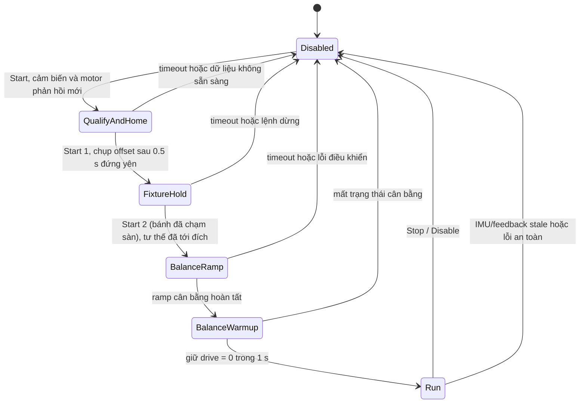

# Ý tưởng firmware TAP: cold-start từ tư thế chân duỗi

## Mục tiêu

Firmware đưa robot vào cân bằng bằng một thao tác Start sau khi người vận hành
nâng đỡ thân và đặt hai chân duỗi thẳng xuống. Khi IMU, encoder và các bus động
cơ sẵn sàng, firmware ghi nhận tư thế đang được giữ làm mốc khớp, vào vòng cân
bằng với lệnh di chuyển bằng không, rồi mới cho phép tháo vật đỡ khi robot đã
tự chịu tải ổn định.

Đây là cách khởi động có tham khảo ý tưởng `coldStart()` trong Impulse. Firmware
dùng bộ điều khiển, mô hình CAD, quy ước trục và phần cứng của TAP; không chép
nguyên linkage, dấu động cơ, gain hay giả định encoder của Impulse.

## Tư thế và ý nghĩa của “zero”

- Trước Start, người vận hành nâng thân robot; hai chân duỗi xuống, gối chạm
  chặn duỗi, thân và chân được giữ yên.
- Khi Start được yêu cầu, firmware đợi IMU/feedback mới và các khớp chân đứng
  yên liên tục 0,5 giây. Sau đó firmware lấy encoder hiện tại làm offset cho
  tư thế đang gá.
- Offset này là mốc phần mềm tương đối cho lần khởi động hiện tại. Nó không
  đặt lại encoder vật lý trong driver và không chứng minh rằng mỗi motor có
  góc zero tuyệt đối sau khi cấp nguồn.
- Mốc đo được được ánh xạ sang tư thế duỗi theo mô hình trọng lực của TAP. Khi
  vào `FixtureHold`, mục tiêu vẫn là tư thế duỗi vừa chụp; firmware không gập
  chân về tư thế natural trước khi thả vật đỡ.
- Pitch của IMU tại thời điểm bắt đầu pha cân bằng được dùng để seed trim góc
  cân bằng. Đây là mốc khởi tạo cho điều khiển, không phải thuật toán tự tìm
  điểm cân bằng bằng cách thử nhiều góc.

## Luồng hoạt động dự kiến

Trình tự chi tiết:

1. **BOOT_SAFE / Disabled** — Driver chưa được yêu cầu chạy cân bằng. Firmware
   đọc MPU6500, bốn joint chân qua CAN và hai bánh qua UART; theo dõi freshness,
   lỗi axis và trạng thái bus.
2. **Qualify và homing thủ công** — Người vận hành giữ thân và chân ở tư thế
   chuẩn bị. Một lệnh Start bắt đầu chờ tư thế yên; khi đạt điều kiện, encoder
   được hiệu chỉnh bằng offset phần mềm. Nếu không đứng yên trong 30 giây hoặc
   feedback không hợp lệ, yêu cầu Enable bị từ chối.
3. **FixtureHold** — Bộ điều khiển giữ nguyên tư thế duỗi đã chụp, bánh chưa
   chạy. Người vận hành đặt hai bánh xuống sàn và giữ thân ở điểm nhẹ tay nhất,
   rồi nhấn **Start lần 2** để release. Không có hạn thời gian cho bước chờ này
   (hạn 15 s chỉ áp dụng khi chân chưa tới tư thế mục tiêu).

   Lý do tách hai lần nhấn (sửa 2026-09-26): chụp mốc cần thân được nhấc, chân
   không tải; cân bằng cần bánh chạm sàn. Với một lần nhấn, release xảy ra
   ~0,2 s sau khi chụp mốc, lúc bánh còn trên không: bánh quay tự do, góc cân
   bằng được seed từ pitch lúc đang nhấc và trim tích phân từ tốc độ bánh quay
   trên không.
4. **BalanceRamp** — Controller chuyển dần sang cân bằng bánh. Lệnh tiến/lùi,
   quay và thay đổi pose vẫn bị chặn.
5. **BalanceWarmup** — Sau khi controller vào `Balance`, giữ lệnh bánh bằng
   không trong 1 giây. Đây là thời gian để quan sát log và xác nhận điều khiển
   còn hoạt động; dòng log `BALANCE MODE active` chỉ báo state machine, không
   chứng minh robot đang tự đứng.
6. **Run** — Sau warmup, mới cho phép lệnh điều hướng. Người vận hành chỉ tháo
   vật đỡ khi quan sát robot thật sự tự chịu tải ổn định.

`Stop`, `Disable`, E-stop, timeout lệnh, IMU stale, feedback stale, lỗi CAN hoặc
quá trình startup timeout phải chặn chuyển động/đưa controller về disable theo
nhánh an toàn. Không dùng tín hiệu contact/force giả định: phần cứng hiện không
có công tắc tiếp xúc chân hay cảm biến lực.

## Phần cứng và quy ước TAP

| Phần | Vai trò |
|---|---|
| ESP32-S3 | Vòng điều khiển firmware 500 Hz và state machine startup |
| MPU6500 qua SPI | Pitch/rate và kiểm tra robot đứng yên; dữ liệu được đổi sang body frame TAP |
| 4 GDS68 qua CAN 500 kbit/s | Khớp hông/gối và feedback encoder/error |
| 2 motor bánh qua UART 1 Mbit/s | Wheel command và feedback bánh |
| BLE Dabble / USB serial GUI | Yêu cầu Start, Stop, E-stop và lệnh điều khiển khi đã vào Run |

Các quy ước quan trọng:

- Thứ tự joint core là `LH, LK, LW, RH, RK, RW`.
- Trục joint CAD là `+Y` ở cả hai bên; không lấy dấu trái/phải từ Impulse.
- PCB IMU đang bị đảo vai trò Pitch/Roll theo thông tin người dùng: firmware
  ánh xạ trục chip sang body frame TAP; pitch dương tương ứng chúi mặt xuống.
- CAN là 500 kbit/s, còn UART bánh là 1 Mbit/s; không đánh đồng hai baud này.
- Firmware không coi encoder position gần zero sau khi driver khởi động là mốc
  zero vật lý.

## Phân lớp phần mềm

| Thành phần | Trách nhiệm |
|---|---|
| `FirmwareApp` | Đọc IMU/gamepad/serial, lấy feedback motor, gọi controller và phát lệnh theo chu kỳ |
| `MotorFeedback` | Freshness, lỗi axis, feedback và offset zero của chân |
| `FirmwareProfile` | Cấu hình bộ điều khiển firmware và startup theo profile TAP |
| `LegHoming` | Ánh xạ tư thế người vận hành đang giữ sang mốc khớp của mô hình |
| `ImpulseStartupSequencer` | Gate các pha Preposition, Release, BalanceRamp, Warmup và Run |
| `EmbeddedController` / LQR | Điều khiển cân bằng TAP và tạo lệnh cho motor |
| `BleCommandEndpoint` | Lệnh BLE và lệnh USB serial dùng chung giao diện command |

Sequencer chạy từng bước trong control loop, không chờ blocking. Nhờ đó firmware
vẫn đọc sensor, cập nhật watchdog và xử lý Stop trong khi startup đang diễn ra.

## Profile đang triển khai

- `esp32-s3-impulse-v2` là profile chẩn đoán: các gate liên quan tới mapping
  tư thế extended và cân bằng từ tư thế đó vẫn khóa Enable.
- `esp32-s3-impulse-v2-full` bật hai gate này theo lựa chọn build để cho phép
  thử chuỗi startup trên phần cứng. Gate được bật trong cấu hình chỉ có nghĩa
  profile cho phép chạy; không phải bằng chứng mapping hoặc cân bằng đã được
  kiểm chứng vật lý.
- Hai lần nhấn Start (`kAutoFixtureRelease = false` trong v2): lần 1 chụp mốc
  và giữ chân, lần 2 (bánh đã chạm sàn) release; sequencer vẫn chỉ cho release
  khi FixtureHold đã tới đích. Test: `impulse_startup_sequencer_tests`.
- Các giới hạn thời gian hiện tại: chờ tư thế/fixture tối đa 15 giây, ramp tối
  đa 2 giây và warmup 1 giây. Homing thủ công chờ yên 0,5 giây, timeout 30 giây.

## Những gì chưa được khẳng định

- Chưa đo chính xác góc gối tại chặn duỗi cơ khí so với CAD zero.
- Chưa chứng minh quan hệ giữa tư thế hông đang gá và góc mục tiêu trong mô
  hình trên toàn dải chuyển động.
- Chưa có bằng chứng closed-loop trên robot rằng robot tự cân bằng thành công
  từ tư thế chân duỗi và có thể tháo vật đỡ an toàn.
- “Đã vào Balance/Run”, feedback motor mới, CAN không lỗi hay build/flash thành
  công đều không đồng nghĩa với cân bằng vật lý.
- Vì vậy, hành vi tháo vật đỡ chỉ là mục tiêu vận hành cần xác nhận bằng một
  thử nghiệm có người giữ an toàn; không được tự động kết luận từ log state.

## Trạng thái phần cứng tại lần ghi tài liệu

Ngày 2026-09-26, profile `esp32-s3-impulse-v2-full` đã được nạp vào ESP32-S3.
Log sau boot ghi nhận IMU `seed=1`, `imu_age=0 ms`, feedback CAN chân và UART
bánh hiện diện; bốn node CAN có `axis_error=0`, `tx_fail=0`, `bus_off=0`. Tại
lần đọc đó `homed=0`, driver chưa được yêu cầu vào trạng thái cân bằng và không
có lệnh Start được gửi. Đây là bằng chứng bring-up sensor/bus, không phải thử
nghiệm chuyển động hay cân bằng.

## Tham chiếu source

- `src_fw/IMPULSE_STYLE_FW_V2.md` — ghi chú port ý tưởng từ Impulse.
- `src_fw/src/ImpulseStartupSequencer.cpp` — các pha startup và timeout.
- `src_fw/src/FirmwareProfile.cpp` — cấu hình controller của profile v2.
- `src_fw/include/tap_fw/BoardConfig.hpp` — bus, IMU map, homing và profile gates.
- `src_fw/include/tap_fw/LegHoming.hpp` và `firmware_esp32/src/FirmwareApp.cpp`
  — chụp offset khi người vận hành giữ tư thế extended.
- `firmware_esp32/src/FirmwareApp.cpp` — tích hợp sensor, feedback, lệnh và
  sequencer vào vòng điều khiển phần cứng.
